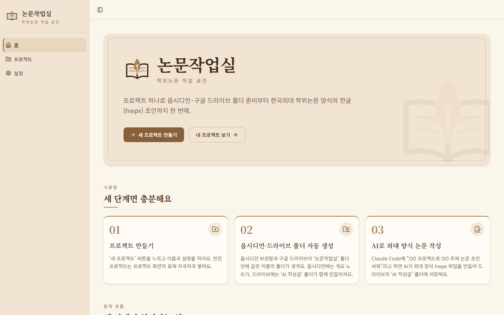
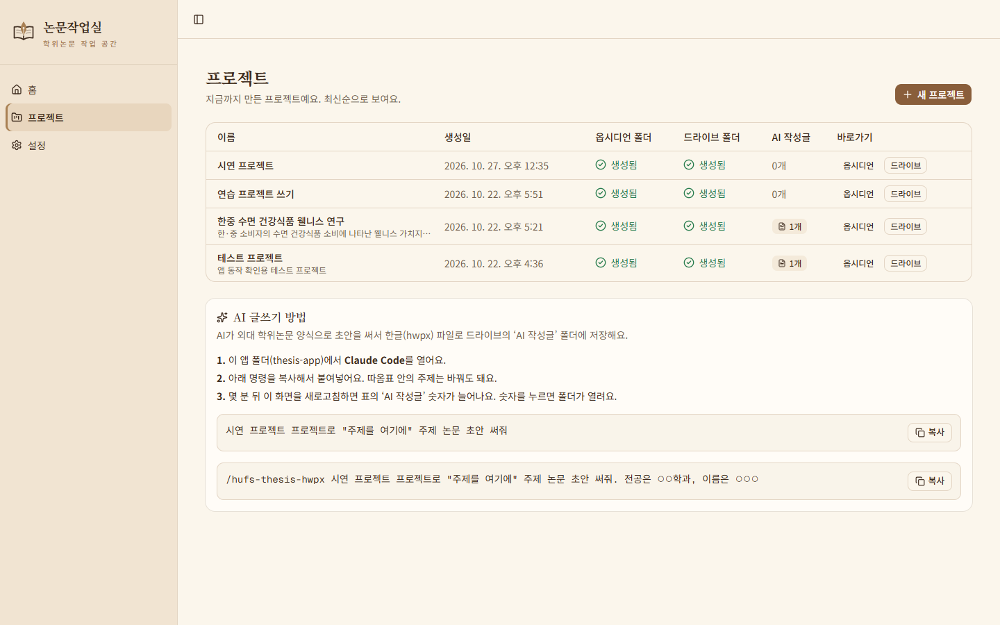
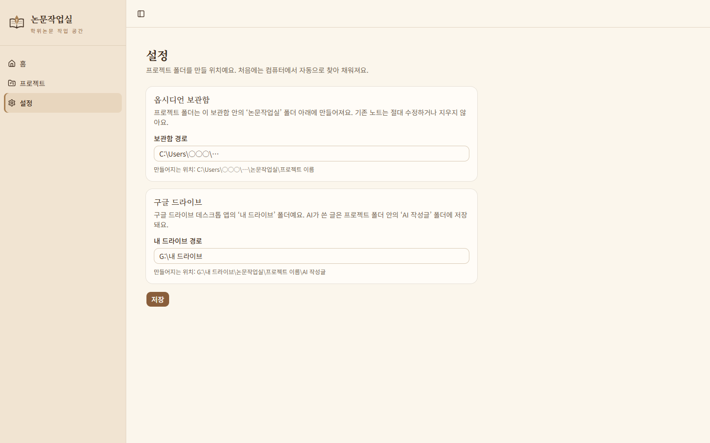

# 논문작업실 (thesis-app)

학위논문 작업을 **프로젝트 단위로 관리**하는 로컬 웹앱입니다.
프로젝트를 만들면 옵시디언 보관함과 구글 드라이브에 같은 이름의 폴더가 자동으로 생기고,
AI(Claude Code)가 쓴 논문 초안을 **한국외대 학위논문 양식의 한글(hwpx) 파일**로 저장합니다.

- 기술 스택: Next.js (App Router, TypeScript) · Tailwind CSS · shadcn/ui
- 화면 구성: 홈(사용법·흐름도) / 프로젝트(생성·히스토리 표) / 설정(폴더 경로)

## 화면 미리보기

**홈** — 앱 소개, 사용법 3단계, 동작 흐름도



**프로젝트** — 프로젝트 만들기, 지금까지 만든 프로젝트 표, AI 글쓰기 방법



**설정** — 옵시디언 보관함과 구글 드라이브 경로



> 스크린샷 속 개인 경로는 `○○○`로 가렸습니다.

## 실행 방법

처음 해 보는 사람도 아래 순서대로 따라 하면 됩니다. (Windows 기준)

### 1. Node.js 설치

1. https://nodejs.org 에 들어가 **LTS** 버전을 내려받아 설치합니다. (설치 화면은 모두 "Next"를 눌러도 됩니다)
2. 설치가 끝나면 **PowerShell**(시작 메뉴에서 검색)을 열고 아래 명령을 입력해 버전 번호가 나오는지 확인합니다.

   ```bash
   node --version
   ```

### 2. 앱 내려받기

- **방법 A (쉬움):** 이 페이지 위쪽의 초록색 **Code** 버튼 → **Download ZIP** → 압축을 풀어 둡니다.
- **방법 B (git 사용):**

  ```bash
  git clone https://github.com/hhyeem33-hub/thesis-app.git
  ```

### 3. 필요한 부품 설치 (처음 한 번만)

PowerShell에서 앱 폴더로 이동한 뒤 설치합니다. 몇 분 걸릴 수 있습니다.

```bash
cd thesis-app
npm install
```

> 압축을 푼 경우 폴더 이름이 `thesis-app-main`일 수 있습니다. 탐색기에서 앱 폴더를 연 뒤 주소창에 `powershell`을 입력하고 Enter를 누르면 그 폴더에서 바로 PowerShell이 열립니다.

### 4. 앱 실행

```bash
npm run dev
```

`Ready`라는 글자가 나오면 준비된 것입니다. 이 창은 끄지 말고 그대로 둡니다. (끝낼 때는 `Ctrl + C`)

### 5. 브라우저에서 열기

브라우저 주소창에 **http://localhost:3000** 을 입력합니다.

### 다른 컴퓨터에서 쓸 때: 경로 설정

옵시디언 보관함과 구글 드라이브 위치는 컴퓨터마다 다릅니다. 앱을 처음 열면 왼쪽 메뉴의 **설정** 화면에서 경로를 확인하세요.

- 앱이 자동으로 찾아 채워 줍니다. 비어 있거나 틀리면 내 컴퓨터의 경로로 고쳐 쓰고 **저장**을 누르면 됩니다.
  - 옵시디언 보관함 예: `C:\Users\내이름\Documents\Obsidian Vault`
  - 구글 드라이브 예: `G:\내 드라이브` (구글 드라이브 데스크톱 앱이 켜져 있어야 함)
- 옵시디언이나 구글 드라이브가 없어도 앱 화면은 모두 둘러볼 수 있습니다. 이때 프로젝트를 만들면 폴더 칸에 실패 표시와 안내가 나옵니다.
- 앱은 각 위치의 `논문작업실` 폴더 안에만 새 파일을 만들고, 기존 파일은 절대 고치거나 지우지 않습니다.

### 그 밖에

- 시연할 때 더 빠르게 쓰려면 `npm run build` 후 `npm run start`.
- AI 논문 초안(hwpx) 만들기에는 Claude Code와 Python 3.12(`python-hwpx` 라이브러리)가 필요합니다.

## 과제 요구사항별 구현 내용

| 요구사항 | 구현 내용 |
|---|---|
| 1. 디자인·인터페이스 품질 | shadcn/ui 컴포넌트, 사이드바 레이아웃, 로딩 화면·툴팁·알림 메시지 |
| 2. 프로젝트 히스토리 테이블 | 프로젝트 화면의 표에 이름·설명·만든 날짜·폴더 상태·AI 작성글 개수 표시 (`data/projects.json`에 저장) |
| 3. 옵시디언·구글 드라이브 폴더 생성 | 프로젝트를 만들면 `<보관함>\논문작업실\<이름>`과 `<내 드라이브>\논문작업실\<이름>` 폴더 생성. 기존 파일은 절대 수정·삭제하지 않고, 같은 이름이 있으면 덮어쓰지 않고 알려 줌 |
| 4. AI 글은 드라이브 별도 폴더에 저장 | `<내 드라이브>\논문작업실\<이름>\AI 작성글` 폴더에 저장 |
| 5. 사용자 친화성·편리성 | 이름 실시간 검사, 실패 시 "다시 시도", 폴더 바로 열기, AI 글쓰기 명령 복사 버튼 |
| 6. 다른 사람이 직접 조작하는 시연 | 로컬 웹앱이라 브라우저만 있으면 누구나 클릭으로 조작 가능, 화면 안내 문구 제공 |
| 7. 대문 페이지 사용법·흐름도 | 홈 화면에 앱 소개, 사용법 3단계, Mermaid 동작 흐름도 |
| 8. 외대 학위논문 양식 hwpx 출력 | Claude Code 스킬 `.claude/skills/hufs-thesis-hwpx/` 제작. 원고(JSON)를 받아 `논문양식.hwpx`의 서식(제목·목차·본문 번호·각주·예문·표·참고문헌) 그대로 hwpx 생성 |

## 폴더 구조

- `app/` 화면과 서버 함수 · `components/` 화면 부품 · `lib/` 파일 저장·폴더 생성·이름 검사
- `data/` 프로젝트 목록과 설정(JSON) · `.claude/skills/hufs-thesis-hwpx/` hwpx 스킬
