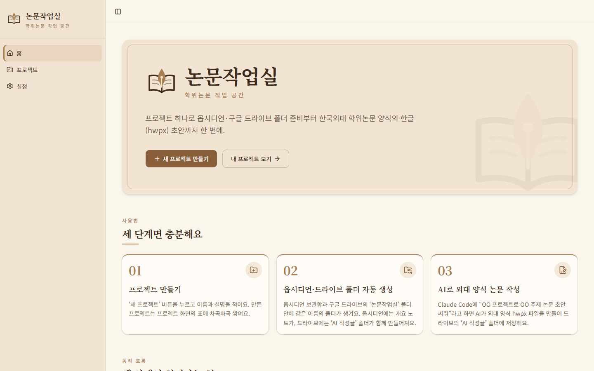
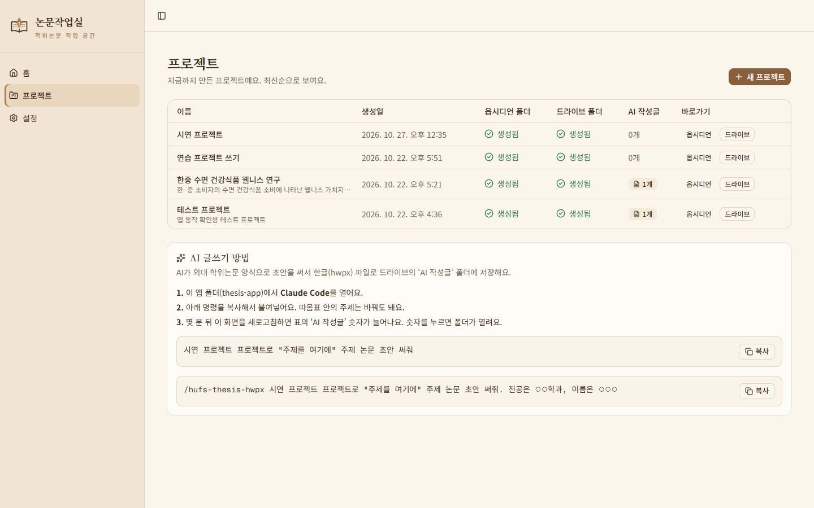
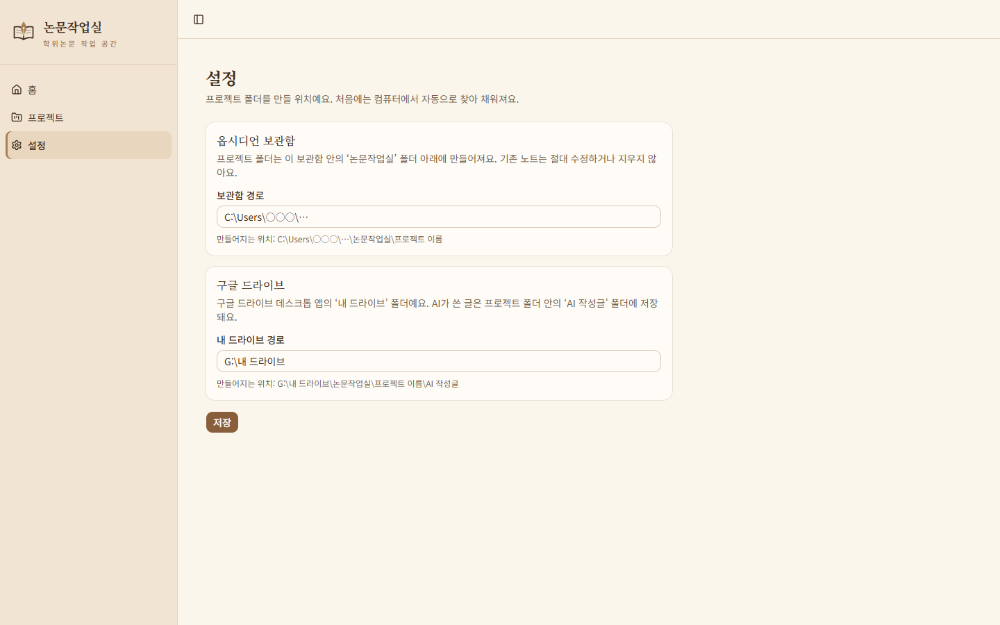

# 논문작업실 (thesis-app)

학위논문 작업을 **프로젝트 단위로 관리**하는 로컬 웹앱입니다.
프로젝트를 만들면 옵시디언 보관함과 구글 드라이브에 같은 이름의 폴더가 자동으로 생기고,
AI(Claude Code)가 쓴 논문 초안을 **한국외대 학위논문 양식의 한글(hwpx) 파일**로 저장합니다.

- 기술 스택: Next.js (App Router, TypeScript) · Tailwind CSS · shadcn/ui
- 화면 구성: 홈(사용법·흐름도) / 프로젝트(생성·히스토리 표) / 설정(폴더 경로)

## 화면 미리보기

**홈** — 앱 소개, 사용법 3단계, 동작 흐름도



**프로젝트** — 프로젝트 만들기, 지금까지 만든 프로젝트 표, AI 글쓰기 방법



**설정** — 옵시디언 보관함과 구글 드라이브 경로



> 스크린샷 속 개인 경로는 `○○○`로 가렸습니다.

## 실행 방법

처음 해 보는 사람도 아래 순서대로 따라 하면 됩니다. (Windows 기준)

### 1. Node.js 설치

1. https://nodejs.org 에 들어가 **LTS** 버전을 내려받아 설치합니다. (설치 화면은 모두 "Next"를 눌러도 됩니다)
2. 설치가 끝나면 **PowerShell**(시작 메뉴에서 검색)을 열고 아래 명령을 입력해 버전 번호가 나오는지 확인합니다.

   ```bash
   node --version
   ```

### 2. 앱 내려받기

- **방법 A (쉬움):** 이 페이지 위쪽의 초록색 **Code** 버튼 → **Download ZIP** → 압축을 풀어 둡니다.
- **방법 B (git 사용):**

  ```bash
  git clone https://github.com/hhyeem33-hub/thesis-app.git
  ```

### 3. 필요한 부품 설치 (처음 한 번만)

PowerShell에서 앱 폴더로 이동한 뒤 설치합니다. 몇 분 걸릴 수 있습니다.

```bash
cd thesis-app
npm install
```

> 압축을 푼 경우 폴더 이름이 `thesis-app-main`일 수 있습니다. 탐색기에서 앱 폴더를 연 뒤 주소창에 `powershell`을 입력하고 Enter를 누르면 그 폴더에서 바로 PowerShell이 열립니다.

### 4. 앱 실행

```bash
npm run dev
```

`Ready`라는 글자가 나오면 준비된 것입니다. 이 창은 끄지 말고 그대로 둡니다. (끝낼 때는 `Ctrl + C`)

### 5. 브라우저에서 열기

브라우저 주소창에 **http://localhost:3000** 을 입력합니다.

### 다른 컴퓨터에서 쓸 때: 경로 설정

옵시디언 보관함과 구글 드라이브 위치는 컴퓨터마다 다릅니다. 앱을 처음 열면 왼쪽 메뉴의 **설정** 화면에서 경로를 확인하세요.

- 앱이 자동으로 찾아 채워 줍니다. 비어 있거나 틀리면 내 컴퓨터의 경로로 고쳐 쓰고 **저장**을 누르면 됩니다.
  - 옵시디언 보관함 예: `C:\Users\내이름\Documents\Obsidian Vault`
  - 구글 드라이브 예: `G:\내 드라이브` (구글 드라이브 데스크톱 앱이 켜져 있어야 함)
- 옵시디언이나 구글 드라이브가 없어도 앱 화면은 모두 둘러볼 수 있습니다. 이때 프로젝트를 만들면 폴더 칸에 실패 표시와 안내가 나옵니다.
- 앱은 각 위치의 `논문작업실` 폴더 안에만 새 파일을 만들고, 기존 파일은 절대 고치거나 지우지 않습니다.

### AI로 초안 쓰기 (Claude API)

1. [Claude 콘솔](https://platform.claude.com)에서 API 키를 만듭니다. (사용한 만큼 요금이 나갑니다. 가장 저렴한 Claude Haiku 5.5 모델을 씁니다)
2. 앱의 **설정 → AI 연결**에 키를 붙여 넣고 **연결 테스트** → **저장**을 누릅니다. 키는 내 컴퓨터의 `data/ai-key.json`에만 저장되고 깃허브에는 올라가지 않습니다.
3. **프로젝트** 화면의 **AI로 초안 쓰기**에서 주제·연구 목적·연구 방법을 적으면 초안이 화면에 나오고, 드라이브의 `AI 작성글` 폴더에 외대 양식 hwpx로 저장됩니다.
4. 확실하지 않은 출처·통계는 `[보완 필요]`로 표시되니 직접 채워 넣으세요.
5. 버셀(온라인)에서는 환경 변수 `ANTHROPIC_API_KEY`의 키를 쓰고, 초안은 화면에만 보여 줍니다(hwpx 저장 없음).

### 자료 모으기와 AI 분류 (대시보드)

1. **연구 설정**에 내 연구 주제와 키워드를 적습니다.
2. **자료 수집**에서 제목·유형(PDF/Markdown/웹/YouTube)·출처·내용을 붙여 넣어 저장하고 프로젝트와 연결합니다.
3. **자료 관리**에서 검색하고, 제목을 눌러 자세히 봅니다.
4. **AI 분류**가 자료를 PARA(Projects/Areas/Resources/Archives)로 나누고, 내 연구와의 관련도(1~5등급)와 요약을 붙입니다. (Claude Haiku 5.5, API 키 필요)
5. **대시보드**에서 전체 자료 수, 평균 관련도, 핵심 자료(4~5등급), 미확인 출처와 그래프 3개를 봅니다.

### 논문 쓰기 (글쓰기 · 각주 · 참고문헌 · 히스토리 · HWPX)

1. **글쓰기** 메뉴에서 프로젝트를 고르고 본문을 써요. 줄 맨 앞에 `#`(장), `##`(절), `###`(목)을 쓰면 1. / 1.1. / 1.1.1 제목이 돼요.
2. 글자를 선택하고 **각주 달기** → 오른쪽에 각주 내용을 적어요. **자료로 각주**를 누르면 라이브러리 자료가 출처로 들어가요.
3. 출처로 쓴 자료는 **참고문헌**에 외대 양식(국문 「논문」『학술지·책』, 한국어 → 중국어 → 영어 순)으로 자동 정리돼요. 모르는 서지 정보는 `[보완 필요]` — 자료 상세의 "서지 정보"에서 채워요.
4. **저장**할 때마다 히스토리에 날짜·시간·글자 수·메모가 남고, 예전 버전 보기·되돌리기가 돼요. **AI 초안** 탭에서 AI가 쓴 초안을 불러와 이어 쓸 수 있어요.
5. **HWPX** 탭에서 외대 양식(또는 내가 올린 양식)으로 본문·각주·참고문헌이 든 한글 파일을 내려받아요 (내 컴퓨터에서만).

### 자료 수집 및 분석 (KCI · 옵시디언 · 구글 드라이브 · 링크 · 목록)

- **KCI 검색**: 국내 학술지 논문. 내 컴퓨터는 API 키로 바로 검색, 온라인은 새 탭 검색 + 주소 붙여넣기.
- **Obsidian 가져오기**: 보관함 Clippings의 새 노트만 (내 컴퓨터 전용, 원본은 읽기만).
- **Google Drive**: PDF · Word(.docx) · 한글(.hwp · .hwpx) · 구글 문서에서 글자를 꺼내 저장. 내 컴퓨터는 드라이브 데스크톱 앱 폴더에서 바로 고르고, 온라인은 구글 로그인 후 파일 선택 창에서 고름 (고른 파일만 읽음, 한 번에 4MB까지).
- **링크(유튜브)**: 유튜브는 제목 · 채널 · 게시일 · 자막(한국어 우선), 일반 웹은 제목 · 본문. 유튜브가 자막을 내주지 않으면 영상 설명을 저장하고 `[보완 필요]`로 표시.
- **목록 가져오기**: RISS · KCI에서 받은 엑셀 · CSV. DOI · KCI 논문 ID · 제목+연도가 같은 자료는 건너뜀.
- 들어온 자료는 모두 바로 AI가 연구 설정 기준으로 관련도를 매김.

### 구글 드라이브 연결 (온라인용, 한 번만 설정)

구글 클라우드에서 "이 앱이 구글 로그인 창을 띄워도 된다"는 허락을 받는 과정이에요. 비밀번호 같은 비밀 값은 쓰지 않아요.

1. https://console.cloud.google.com 에 구글 계정으로 들어가 위쪽 프로젝트 선택 → **새 프로젝트** → 이름 `thesis-app` → 만들기.
2. 왼쪽 메뉴 **API 및 서비스 → 라이브러리**에서 **Google Drive API**와 **Google Picker API**를 각각 검색해 **사용** 누르기.
3. **API 및 서비스 → OAuth 동의 화면**(Google 인증 플랫폼): 앱 이름 `논문작업실`, 사용자 지원 이메일 = 내 이메일, 대상 **외부** → 만들기. **데이터 액세스**에서 범위 추가 → `.../auth/drive.file` 체크 → 저장. **대상**에서 **앱 게시**(프로덕션)를 누르면 교수님 등 누구나 로그인할 수 있어요. (게시 전에는 **테스트 사용자**에 넣은 계정만 돼요)
4. **API 및 서비스 → 사용자 인증 정보 → 사용자 인증 정보 만들기 → OAuth 클라이언트 ID**: 유형 **웹 애플리케이션**, **승인된 JavaScript 원본**에 `https://<내 버셀 주소>` 와 `http://localhost:3000` 추가 → 만들기 → **클라이언트 ID** 복사.
5. 같은 화면에서 **사용자 인증 정보 만들기 → API 키** → 만든 키의 **키 제한**: 애플리케이션 제한 **웹사이트** → `https://<내 버셀 주소>/*`, `http://localhost:3000/*` 추가, API 제한 **Google Picker API** 만 → 저장 → 키 복사.
6. 위쪽 프로젝트 이름을 눌러 **프로젝트 번호**(숫자) 복사.
7. 버셀 → 프로젝트 → **Settings → Environment Variables**에 3개 추가 후 **Redeploy**:
   - `NEXT_PUBLIC_GOOGLE_CLIENT_ID` = 4번의 클라이언트 ID
   - `NEXT_PUBLIC_GOOGLE_API_KEY` = 5번의 API 키
   - `NEXT_PUBLIC_GOOGLE_APP_ID` = 6번의 프로젝트 번호
8. (선택) 내 컴퓨터에서도 구글 로그인으로 고르려면 같은 3줄을 `.env.local`에 넣고 앱을 다시 실행해요.

### 출력 (글쓰기 → 출력 탭)

- **PDF**(인쇄 창에서 "PDF로 저장") · **한글(HWPX)** · **워드(DOCX, 각주는 쪽 아래)** · **HTML** · **Markdown**.
- 내려받기 전에 **확인할 곳**(`[보완 필요]` 개수, 출처 없는 각주 수)을 보여 주고, 그래도 내려받을 수 있어요.
- 한글은 올린 양식이 있으면 그 양식, 없으면 외대 기본 양식. 한글은 내 컴퓨터의 파이썬으로 만들어서 **온라인에서는 안 되고**, 나머지 4가지는 온라인에서도 돼요.
- 아래 **임시저장**(히스토리 없이 보관) · **저장**(히스토리에 버전 기록).

### KCI 검색 (선행연구)

- 키가 없을 때: **KCI 검색** 메뉴 → "KCI에서 검색(새 탭)" → 마음에 드는 논문 주소를 복사해 붙여 넣으면 제목·저자·학술지·연도·초록이 채워지고, "라이브러리에 선행연구로 저장".
- KCI API 키가 있을 때(설정 → KCI 연결): 앱 안에서 바로 검색하고 저장. KCI API는 신청한 IP에서만 돼서 내 컴퓨터에서만 써요.

### 온라인(버셀) + 슈파베이스

- 버셀 주소에서는 프로젝트 기록과 AI 초안 기록이 슈파베이스 데이터베이스에 저장됩니다. 옵시디언·드라이브 폴더는 내 컴퓨터에서만 만들어집니다.
- 처음 한 번, 슈파베이스 대시보드의 **SQL Editor**에서 [`supabase/schema.sql`](supabase/schema.sql) 내용을 붙여 넣고 **Run**을 눌러 표를 만듭니다.
- 데이터베이스 키는 버셀 환경 변수에만 있고 깃허브에는 올리지 않습니다.

### 그 밖에

- 시연할 때 더 빠르게 쓰려면 `npm run build` 후 `npm run start`.
- AI 논문 초안(hwpx) 만들기에는 Claude Code와 Python 3.12(`python-hwpx` 라이브러리)가 필요합니다.

## 과제 요구사항별 구현 내용

| 요구사항 | 구현 내용 |
|---|---|
| 1. 디자인·인터페이스 품질 | shadcn/ui 컴포넌트, 사이드바 레이아웃, 로딩 화면·툴팁·알림 메시지 |
| 2. 프로젝트 히스토리 테이블 | 프로젝트 화면의 표에 이름·설명·만든 날짜·폴더 상태·AI 작성글 개수 표시 (`data/projects.json`에 저장) |
| 3. 옵시디언·구글 드라이브 폴더 생성 | 프로젝트를 만들면 `<보관함>\논문작업실\<이름>`과 `<내 드라이브>\논문작업실\<이름>` 폴더 생성. 기존 파일은 절대 수정·삭제하지 않고, 같은 이름이 있으면 덮어쓰지 않고 알려 줌 |
| 4. AI 글은 드라이브 별도 폴더에 저장 | `<내 드라이브>\논문작업실\<이름>\AI 작성글` 폴더에 저장 |
| 5. 사용자 친화성·편리성 | 이름 실시간 검사, 실패 시 "다시 시도", 폴더 바로 열기, AI 글쓰기 명령 복사 버튼 |
| 6. 다른 사람이 직접 조작하는 시연 | 로컬 웹앱이라 브라우저만 있으면 누구나 클릭으로 조작 가능, 화면 안내 문구 제공 |
| 7. 대문 페이지 사용법·흐름도 | 홈 화면에 앱 소개, 사용법 3단계, Mermaid 동작 흐름도 |
| 8. 외대 학위논문 양식 hwpx 출력 | Claude Code 스킬 `.claude/skills/hufs-thesis-hwpx/` 제작. 원고(JSON)를 받아 `논문양식.hwpx`의 서식(제목·목차·본문 번호·각주·예문·표·참고문헌) 그대로 hwpx 생성 |

## 폴더 구조

- `app/` 화면과 서버 함수 · `components/` 화면 부품 · `lib/` 파일 저장·폴더 생성·이름 검사
- `data/` 프로젝트 목록과 설정(JSON) · `.claude/skills/hufs-thesis-hwpx/` hwpx 스킬
